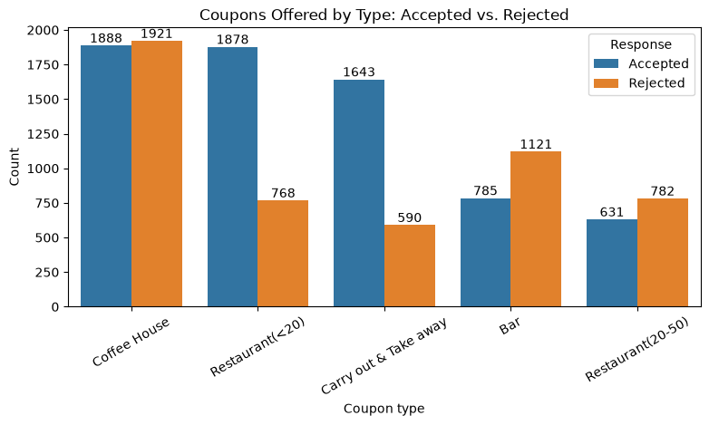
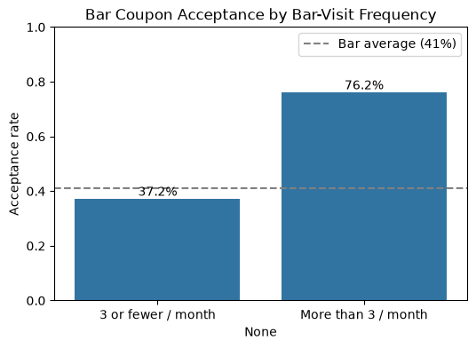
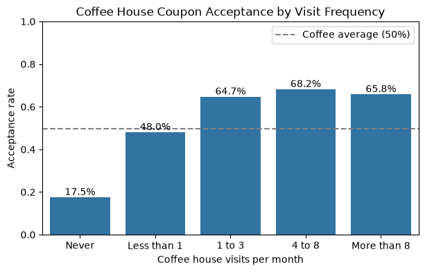
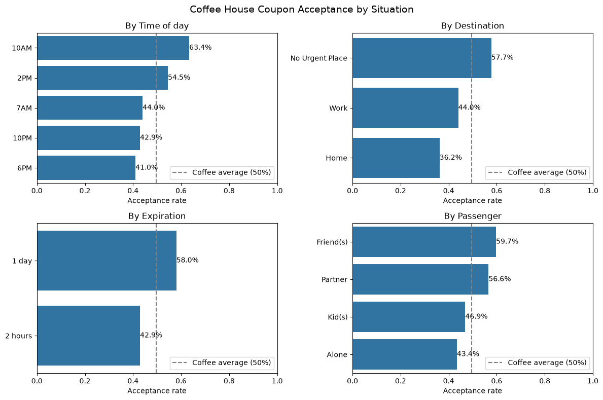

# Will the Customer Accept the Coupon?

Required Assignment 5.1.

**Full analysis:** [coupon_analysis.ipynb](coupon_analysis.ipynb)

## The question

A driver gets a coupon on their phone for a business nearby. Will they use it?

This project looks at survey answers from 12,007 driving scenarios (after cleaning) to find what separates drivers who **accept** a coupon from drivers who **reject** it. This data is from the UCI Machine Learning Repository and was collected via a survey on Amazon Mechanical Turk. There are five coupon types - coffee house, bar, carry out, cheap restaurant (under 20 dollars) and more expensive restaurant (20 to 50 dollars).

## Summary

- **56.8% of drivers accepted the coupon** - a small majority.
- **The type of coupon matters most** - carry out (74%) and cheap restaurant (71%) coupons are accepted most. Bar (41%) and expensive restaurant (45%) coupons are accepted least. Coffee house is in the middle (50%).
- **Habit is the strongest sign** - people who already go to bars or coffee houses are the ones who accept those coupons. People who never go almost always say no.
- **Timing matters** - coffee coupons work best in the morning, bar coupons in the evening.

## Bar coupons - who accepts and who does not

Overall, 41.2% of bar coupons were accepted.

**More likely to accept:**
- Go to a bar more than 3 times a month - 76% accept
- Travelling with friends - 57%
- Single, or no children - 50% to 55%
- Coupon received in the evening (6PM, 10PM) - about 46%

**Less likely to accept:**
- Never go to bars - only 19% accept
- Kids in the car - 21%
- Married, or have children - about 30%

**What did not matter:** age (among regular bar-goers), occupation, and how long the coupon was valid.

## Coffee house coupons - who accepts and who does not

Overall, 49.6% of coffee house coupons were accepted - almost an even split.

**More likely to accept:**
- Visit a coffee house at least once a month - 66% accept
- Coupon received at 10AM - 63%
- No urgent place to be - 58%
- Coupon valid for a full day - 58%
- Coffee house less than 15 minutes away - 54%
- **All together** - a regular visitor who gets the coupon at 10AM or 2PM with a full day to use it accepts **81%** of the time

**Less likely to accept:**
- Never visit coffee houses - only 18% accept
- Coupon received in the evening (6PM) - 41%
- Driving home - 36%
- Coupon valid for only 2 hours - 43%
- Coffee house 25 minutes or more away - 34%

**What did not matter:** gender, children and income. For coffee, *when and where* the coupon is sent matters more than *who* the driver is.

## Recommendations

1. **Target existing customers** - send bar and coffee coupons to people who already visit at least once a month.
2. **Match the time to the place** - coffee coupons in the morning (10AM is best), bar coupons in the evening (6PM, 10PM).
3. **Give coffee coupons a full day** - a 1 day coupon is accepted 58% of the time, a 2 hour coupon only 43%.
4. **Do not send bar coupons when kids are in the car** - only 21% accept. Drivers with friends are the best audience (57%).
5. **Use nearby coffee houses** - acceptance drops from 54% (under 15 minutes away) to 34% (25 minutes or more).

## Next steps

- **Test in the real world** - this is survey data (what people say they would do). A small test with real coupons would confirm the results.
- **Look at the other coupon types** - carry out, cheap restaurant and expensive restaurant coupons were not analyzed in detail.

## Repository contents

| File / folder | What it is |
| --- | --- |
| [coupon_analysis.ipynb](coupon_analysis.ipynb) | Jupyter notebook with the full analysis |
| [data/coupons.csv](data/coupons.csv) | Survey data |
| [images/](images/) | Charts used in the notebook and this README |

